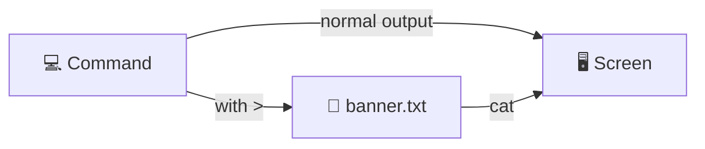

<div align="center">

# 🐧 Day 2 – Basic Linux Commands


</div>

---

## 📌 Overview

| Lab | Topic | Key Skills |
|:---:|-------|-----------|
| 1️⃣ | Terminal & identity | `echo`, `whoami`, `id`, `id -un` |
| 2️⃣ | ASCII-art banner | Output redirection with `>` |

---

## 🧪 Lab 1: Terminal Basics & Identity Commands

### 🎯 What I learned
- ✅ Opening and using the terminal
- ✅ Basic commands: `echo`, `whoami`, `id`
- ✅ Extracting a single identity detail with `id -un`

### 💻 Command Cheat Sheet

| Command | What it does | Example output |
|---------|--------------|----------------|
| `echo "text"` | Prints text to the terminal | `text` |
| `whoami` | Shows the current username | `ec2-user` |
| `id` | Shows UID, GID, and groups | `uid=1000(ec2-user) gid=1000(ec2-user) ...` |
| `id -un` | Shows only the username | `ec2-user` |

```bash
echo "Hello, Linux"   # print text
whoami                # current username
id                    # full identity info
id -un                # username only (-u = user, -n = name)
```

> [!TIP]
> `id -un` gives the same result as `whoami`. Flags let you narrow a command's output to exactly what you need.

<details>
<summary>🔍 <b>Breaking down <code>id -un</code></b></summary>

| Part | Meaning |
|------|---------|
| `id` | Print user identity |
| `-u` | Only the **user** ID |
| `-n` | Show the **name** instead of the number |

</details>

---

## 🎨 Lab 2: Saving an ASCII-Art Banner

### 🎯 What I learned
- ✅ Combining two commands with one redirection operator
- ✅ Saving command output into a reusable file

### 🔀 How redirection works



```bash
# Replace with the exact commands from your lab
echo "  MY BANNER  " > banner.txt   # save output to a file
cat banner.txt                      # display the saved banner
```

> [!WARNING]
> `>` **overwrites** the file. Use `>>` to **append** instead.

| Operator | Action |
|:--------:|--------|
| `>` | Write output to a file (overwrite) |
| `>>` | Add output to the end of a file (append) |

---

## 💡 Key Takeaways

> [!NOTE]
> - Simple commands become powerful when combined with **flags** and **redirection**.
> - `>` turns any command's output into a file you can reuse.

<div align="center">

⬅️ [Day 1](./day-01.md) | [🏠 Home](../README.md) | [Day 3](./day-03.md) ➡️

</div>